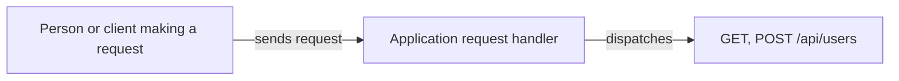

# RepoStory

[](https://nodejs.org/)
[](https://nextjs.org/)
[](https://react.dev/)
[](https://www.typescriptlang.org/)

**RepoStory — explain your codebase to anyone.**

Turn a public GitHub repository into evidence-backed architecture and workflow
diagrams that people can understand, review, and reuse in technical
documentation.

RepoStory is designed for the gap between source code and the people who need
to understand it: developers, clients, product teams, investors, students, and
other stakeholders. It presents both technical labels and plain-English
explanations while keeping the static analysis layer as the source of truth.

> RepoStory presents static, evidence-backed interpretations of repository
> contents. Inferred relationships are marked with confidence information and
> should be reviewed by the project owner.

This repository contains the current synchronous Phase 3 implementation. It is
not a claim that every repository can be completely or perfectly understood.

## Contents

- [What RepoStory does](#what-repostory-does)
- [Product preview](#product-preview)
- [Core capabilities](#core-capabilities)
- [How RepoStory works](#how-repostory-works)
- [Architecture](#architecture)
- [Analysis stages](#analysis-stages)
- [Evidence and confidence model](#evidence-and-confidence-model)
- [Supported diagram types](#supported-diagram-types)
- [Editing and export workflow](#editing-and-export-workflow)
- [Security and privacy](#security-and-privacy)
- [Quickstart](#quickstart)
- [API reference](#api-reference)
- [Testing](#testing)
- [Current limitations](#current-limitations)
- [Roadmap](#roadmap)
- [Contributing](#contributing)
- [License and acknowledgements](#license-and-acknowledgements)

## What RepoStory does

Explaining a codebase usually requires someone to translate directory names,
entry points, imports, API handlers, dependencies, and configuration into a
story. A folder tree alone does not show which files connect, which routes are
exposed, or which conclusions are certain.

RepoStory reads repository files as text and turns observable relationships into
structured findings. Those findings can become:

- repository structure diagrams;
- conservative system overviews;
- API request-flow diagrams when route evidence exists;
- authentication-flow diagrams when meaningful authentication evidence exists;
- technical labels and plain-English labels;
- source-linked evidence references with redacted excerpts;
- Mermaid source; and
- README-ready Markdown.

The current implementation deliberately separates deterministic analysis from
presentation. The analyzers inspect package manifests, conventional paths,
source text, imports, and configuration. The UI then presents those findings in
an editable React Flow workspace. There is no separate AI or hosted model
service in this codebase.

### A small example

The following is an **illustrative** explanation pattern, not a diagram copied
from a particular repository:

```text
User
  → Web interface
  → API route
  → Local service or module
  → Database or external service
```

RepoStory only draws a relationship like this when the analyzed repository
contains evidence for the relevant parts. If a route method, integration, or
authentication boundary cannot be confirmed, the result keeps that uncertainty
visible instead of presenting it as fact.

## Product preview

The current repository does not include committed product screenshots. Run the
application locally to inspect the landing page, analysis progress state,
results workspace, diagram editor, evidence panel, and clipboard export flow.

The committed `public/` assets are the default static assets from the Next.js
starter setup, not product screenshots.

## Core capabilities

The table below describes what is implemented in the current repository. “Static
only” means that the feature reports repository evidence; it does not execute
the analyzed application or prove runtime behavior.

| Capability | What it does | Evidence or status |
| --- | --- | --- |
| Public GitHub ingestion | Fetches repository metadata, the recursive tree, and bounded file contents from the GitHub API. | **Available**, subject to network access and GitHub API limits. |
| Fixture ingestion | Runs the same pipeline against JSON repository snapshots. | **Available in tests** through `FixtureRepositoryProvider`; it is the offline path. |
| URL validation and branch parsing | Accepts `https://github.com/{owner}/{repository}` and `/tree/{branch}` references, with optional request-body branch selection. | **Available**; credentials, queries, fragments, unsafe branches, and other hosts are rejected. |
| Bounded file filtering | Sorts files, excludes generated/dependency directories and unsupported files, and enforces file-count and byte budgets. | **Available**; defaults are documented in [Security and privacy](#security-and-privacy). |
| Secret-bearing file exclusion | Skips paths such as `.env`, private-key files, credential files, and known secret config files, while allowing `.env.example`, `.env.sample`, and `.env.template`. | **Available**, heuristic rather than a guarantee of secret discovery. |
| Secret redaction | Redacts recognized token formats, connection strings, private keys, bearer values, and secret-looking assignments before evidence and exports are returned. | **Available** with regression coverage. |
| Technology detection | Detects the repository signatures implemented in the analyzer, including Node.js/React, TypeScript, Next.js, and Docker. | **Available but intentionally limited**; it is not a general language/framework detector. |
| Directory and entry-point detection | Finds top-level source areas and conventional orientation files such as `README.md`, `package.json`, `src/app/page.tsx`, and `index.*`. | **Available**. |
| API route detection | Detects Next.js App Router, Next.js Pages Router, Express, and router-style handlers. | **Available**; explicit methods are reported and ambiguous methods become `UNKNOWN` with verification confidence. |
| Local module relationships | Resolves static, dynamic, and `require` imports against local files and supported TypeScript path aliases. | **Available**; dynamic runtime resolution outside the supported patterns is not proven. |
| Database evidence | Detects supported database packages, imports/client initialization, Prisma schemas, and SQL migrations. | **Available**, static only. |
| External-service evidence | Detects supported service packages/client patterns and generic external HTTP calls. | **Available**, static only. |
| Authentication evidence | Detects configured providers and patterns for Auth.js/NextAuth, Clerk, Supabase Auth, JWT, sessions, OAuth/OpenID Connect, and authentication-aware middleware. | **Available**, but it does not execute or verify a login flow. |
| Evidence references | Attaches file paths, line information, redacted excerpts, and reasons to findings and diagram elements. | **Available**. |
| Confidence levels | Carries `high`, `medium`, `low`, and `needs-verification` through the domain model. | **Available**; the current detectors primarily emit high, medium, and needs-verification findings. |
| Plain-English architecture story | Leads with what the application appears to do, then shows request steps, coverage, confidence, caveats, and source-backed technical evidence. | **Available**; the narrative stays conservative when a diagram or request flow is unavailable. |
| Repository structure diagram | Maps the repository name to detected top-level directories. | **Available** for completed analyses. |
| System overview diagram | Connects a user, application, and detected technologies when technology evidence exists. | **Conditional**. |
| API request-flow diagram | Connects a client, detected routes, related local modules, database evidence, and integration evidence. | **Conditional** on route evidence. |
| Authentication-flow diagram | Maps authentication evidence, optional session/token state, related modules, and detected endpoints. | **Conditional** on meaningful authentication evidence. |
| React Flow preview | Renders the generated diagrams in the browser with technical/plain-English label modes. | **Available** through `@xyflow/react`. |
| Diagram editing | Edits titles, descriptions, notes, node and edge labels, explanations, visibility, and direction. | **Available** for generated nodes and edges; arbitrary new elements are not supported. |
| Undo, redo, reset, and save | Keeps a browser draft history, persists valid edits through the diagram API, and restores the generated baseline. | **Available** within the process-local store. |
| Mermaid export | Returns Mermaid flowchart source containing only visible nodes and valid visible edges. | **Available** through the UI and `POST /api/exports`. |
| README Markdown export | Returns Markdown with a Mermaid block, components, connections, confidence, optional explanations, optional evidence, and optional attribution. | **Available**; the browser copies content to the clipboard rather than downloading a file. |
| Synchronous analysis | Completes the bounded pipeline in the request and stores the completed result. | **Available**; no background worker is started. |
| Offline fixture tests | Exercises analysis and security behavior without GitHub network access. | **Available** through `make test`. |

## How RepoStory works

The implemented path is:

```mermaid
flowchart LR
  url["Repository URL"] --> validate["Validate GitHub URL and branch"]
  validate --> metadata["Retrieve GitHub metadata"]
  metadata --> tree["Retrieve file tree and contents"]
  tree --> filter["Filter files, limits, and secret-bearing paths"]
  filter --> static["Run deterministic static analyzers"]
  static --> evidence["Collect redacted evidence"]
  evidence --> confidence["Assign confidence"]
  confidence --> diagrams["Generate available diagrams"]
  diagrams --> edit["Interactive editing"]
  edit --> export["Mermaid or README Markdown export"]
```



The first implementation is synchronous and bounded:

1. The API validates the request with Zod and parses the GitHub URL.
2. The repository provider reads metadata, the recursive tree, and selected
   file contents from `api.github.com`.
3. File paths are validated before content requests are made. The filter then
   removes generated/dependency directories, secret-bearing files, unsupported
   file types, and files over the configured byte budgets.
4. Source text is inspected without executing repository code. Detectors find
   technologies, directories, entry points, HTTP routes, local imports,
   database evidence, external-service evidence, and authentication evidence.
5. Each finding receives source-backed evidence and a confidence level.
6. Diagram generators omit diagrams when their evidence preconditions are not
   met. The analysis response reports those availability decisions.
7. Diagrams are saved in the process-local in-memory store and rendered in the
   React Flow workspace.
8. Edits are validated server-side. Mermaid and Markdown serializers preserve
   visible, redacted, escaped content.

The analyzed repository is treated as text. RepoStory does **not** execute
repository code, install the analyzed repository's dependencies, or start its
services. The analysis budget is bounded by file, response, content, path, and
time limits. A fixture provider is used by the test suite so the deterministic
pipeline can run offline.

The current explanation layer is the deterministic `plainEnglishLabel`,
`explanation`, and `technicalDetail` data emitted by the analyzers and diagram
generators. It is not an optional LLM pass. A public multi-user deployment
would also need an ownership/session boundary because the current store is
process-local.

## Architecture

The following diagram reflects the current source layout and request paths. It
does not include a database, queue, worker, AI provider, or user-authentication
service because none of those components is implemented in this repository.

```mermaid
flowchart LR
  browser["Browser UI<br/>Next.js App Router"]
  analyze["POST /api/analyze"]
  parser["parseGitHubUrl"]
  provider["GitHubPublicRepositoryProvider"]
  github["GitHub Public API<br/>api.github.com"]
  filter["filterFiles<br/>limits and redaction"]
  analyzers["Deterministic analyzers<br/>technology, routes, modules,<br/>databases, integrations, auth"]
  evidence["Evidence collector"]
  generators["Diagram generators"]
  store["InMemoryAnalysisStore<br/>TTL and capacity bounds"]
  reads["Analysis read routes<br/>/api/analysis/:id"]
  diagramApi["Diagram routes<br/>GET, PATCH, reset"]
  flow["React Flow results<br/>preview and editor"]
  exportsApi["POST /api/exports"]
  serializers["Mermaid and Markdown<br/>serializers"]

  browser --> analyze
  analyze --> parser
  parser --> provider
  provider --> github
  provider --> filter
  filter --> analyzers
  analyzers --> evidence
  evidence --> generators
  generators --> store
  store --> reads
  reads --> flow
  flow --> diagramApi
  diagramApi --> store
  flow --> exportsApi
  exportsApi --> store
  exportsApi --> serializers
  serializers --> browser
```



### Code organization

```text
src/
├── app/
│   ├── page.tsx                         # landing page and URL submission
│   ├── analysis/[analysisId]/page.tsx   # analysis route shell
│   └── api/                             # Next.js route handlers
├── components/RepoAnalysis.tsx          # React Flow workspace and editor
├── analysis/                            # static detectors, diagrams, exports
├── application/
│   ├── pipeline.ts                       # synchronous analysis orchestration
│   ├── store.ts                          # process-local analysis/diagram store
│   └── diagram-edits.ts                  # validated edit transformation
├── composition/container.ts              # runtime provider/store wiring
├── domain/                               # analysis, finding, diagram, export types
├── infrastructure/providers/             # GitHub and fixture repository providers
└── shared/                               # limits, redaction, HTTP, text, IDs

fixtures/repositories/                    # offline repository snapshots
tests/                                     # unit, component, and Playwright tests
```

The runtime composition in `src/composition/container.ts` wires the GitHub
provider to the `InMemoryAnalysisStore`. `FixtureRepositoryProvider` is imported
by tests and is not the production provider selected by the web application.

## Analysis stages

| Stage | Purpose | Output | Execution model |
| --- | --- | --- | --- |
| URL validation | Accept only supported GitHub URL shapes and reject unsafe branches or hosts. | `RepositoryReference` or structured error. | Deterministic. |
| Repository metadata retrieval | Read the repository ID, name, description, default branch, and size metadata. | Repository metadata. | GitHub network access; fixture provider can replace it in tests. |
| File-tree retrieval | Read the recursive Git tree, reject truncated/invalid trees, and fetch bounded file contents as base64. | `RepositorySnapshot`. | GitHub network access; path and response checks are deterministic. |
| File filtering | Normalize paths and exclude dependencies, generated output, secret-bearing paths, unsupported types, and over-budget files. | Bounded analyzable file set. | Deterministic. |
| Secret redaction | Remove recognized secrets from descriptions, evidence excerpts, labels, and export text. | Safe text values. | Deterministic heuristics. |
| Technology detection | Inspect configured file signatures for the implemented technology findings. | Technology findings. | Deterministic. |
| Directory detection | Group analyzed files by top-level directory. | Directory findings. | Deterministic. |
| Entry-point detection | Match conventional README, package, page, and index paths. | Entry-point findings. | Deterministic heuristic. |
| API route detection | Inspect Next.js route filenames, Pages Router handlers, and Express/router calls. | Route findings with methods and evidence. | Deterministic static patterns. |
| Module relationship detection | Resolve local imports, dynamic imports, `require`, and supported aliases without running code. | Module relationship findings. | Deterministic static resolution. |
| Database detection | Combine dependency, import, client initialization, Prisma schema, and SQL migration evidence. | Database findings. | Deterministic static patterns. |
| External-service detection | Match named client packages/initialization and generic external HTTP calls. | Integration findings. | Deterministic static patterns. |
| Authentication detection | Match provider, JWT, session, OAuth, and middleware evidence. | Authentication findings. | Deterministic static patterns; not a login test. |
| Evidence collection | Record path, line, redacted excerpt, and reason for each finding. | `EvidenceReference[]`. | Deterministic. |
| Confidence assignment | Preserve direct, inferred, and unresolved states. | Confidence on findings, nodes, edges, and availability. | Deterministic heuristic. |
| Diagram generation | Build repository, system, API, and authentication diagrams only when their evidence conditions are met. | `Diagram` objects and availability reasons. | Deterministic and conditional. |
| Editing and persistence | Validate edits, preserve evidence, and store the edited diagram. | Updated diagram in the in-memory store. | Synchronous and process-local. |
| Export generation | Serialize visible diagram content to Mermaid or Markdown. | JSON export response with content, filename, and MIME type. | Deterministic. |

## Evidence and confidence model

Every finding, diagram node, and diagram edge carries evidence and confidence
data. This is the boundary that keeps a plausible explanation from becoming an
unsupported assertion.

### Evidence references

An `EvidenceReference` contains:

| Field | Meaning |
| --- | --- |
| `id` | Stable identifier derived from the file path and evidence reason. |
| `filePath` | Repository-relative path where the evidence was found. |
| `lineStart` / `lineEnd` | Line information when the collector can associate the evidence with a source line. The current collector records a single line for most findings. |
| `symbol` | Optional symbol field in the domain model. The current generic evidence collector does not normally populate it. |
| `excerpt` | A redacted, truncated source line or excerpt when available. The default stored excerpt limit is 1,000 characters. |
| `reason` | Plain-language explanation of why the file supports the finding. |

Evidence is collected from repository text and package manifests. It is not a
runtime trace. Exports apply another truncation limit to evidence excerpts and
escape user-controlled Markdown characters.

### Confidence levels

```text
High              Directly observed in source or configuration.
Medium            Strongly inferred from multiple observations or a supported convention.
Low               Plausible but incomplete; the domain model supports this state.
Needs verification Cannot be confirmed from the available repository evidence.
```

Examples of the distinction in the current implementation:

- an exported `GET` handler in a recognized Next.js route file can receive
  high confidence;
- an alias-resolved local import can receive medium confidence;
- a route filename with no explicit method is emitted as `UNKNOWN` with
  `needs-verification` confidence; and
- an authentication diagram may show that an endpoint *may* be evaluated by an
  authentication boundary, but the edge is marked `needs-verification` because
  static analysis cannot prove that the endpoint is protected.

The `low` value is part of the shared domain contract, but the current checked
detectors primarily produce `high`, `medium`, and `needs-verification`. Diagram
generators preserve the confidence they receive instead of upgrading weak
evidence.

## Supported diagram types

| Diagram | Question it answers | When it appears |
| --- | --- | --- |
| Repository structure | What are the repository's top-level source areas? | Generated for a completed analysis from the analyzed file paths. |
| System overview | What application and technology signals are visible at a high level? | When technology findings and evidence exist. |
| API request flow | How could a request move from a client to the detected endpoints and related evidence? | When at least one evidence-backed API route is detected. Database, integration, and local-module nodes are added only when corresponding findings relate to the flow. |
| Authentication flow | What identity, token/session, provider, middleware, and endpoint evidence is present? | When meaningful authentication evidence exists. Findings that are only `needs-verification` do not create this diagram. |

The pipeline returns `diagramAvailability` for all four types. If a diagram is
omitted, the response includes a reason such as “No evidence-backed API routes
were detected” or “Not enough technology evidence was found.” The UI shows
those reasons instead of silently presenting an empty map.

The following is a shape produced by the API request-flow generator when a
recognized route exists. The exact IDs and optional nodes vary by repository:



The labels and edge verbs above match the generator's current plain-English
labels for the corresponding node and edge roles; they are not a promise that
every repository has a `/api/users` route.

## Editing and export workflow

The results page is a React Flow workspace backed by the generated `Diagram`
object.

### Editing

The current UI supports:

- switching between technical labels and plain-English labels;
- editing the diagram title, description, and custom note;
- selecting a generated node or edge;
- editing node technical labels, plain-English labels, and explanations;
- editing edge labels and explanations;
- hiding or showing selected nodes and edges;
- changing direction between top-to-bottom, left-to-right, right-to-left, and
  bottom-to-top;
- undoing and redoing browser-local draft changes;
- saving a validated draft through `PATCH /api/diagrams/:diagramId`; and
- resetting the diagram to the generated baseline through
  `POST /api/diagrams/:diagramId/reset`.

Edits change presentation fields and visibility while preserving the evidence
attached to the generated elements. The server trims control characters,
redacts secret-like values, limits text fields to 5,000 characters, validates
the direction, and rejects unknown node or edge IDs. The editor does not create
arbitrary new nodes or edges.

### Export behavior

The export route accepts `mermaid` and `markdown` formats. Its options control
whether Markdown includes explanations, evidence, and the optional attribution
line. Mermaid contains visible nodes and visible edges whose endpoints are also
visible. Markdown follows the same visibility rules and includes confidence
notes for visible components and connections.

Exports also:

- preserve saved user-edited labels and notes;
- exclude evidence from secret-bearing paths;
- redact recognized secret values again at serialization time;
- escape Mermaid labels so quotes and structural characters cannot change the
  generated graph;
- escape Markdown metacharacters and HTML-like content; and
- optionally append `_Generated by RepoStory from public repository evidence._`.

The browser saves unsaved changes before requesting an export and copies the
returned content to the clipboard. The HTTP API returns content, a filename,
and a MIME type; it does not create a durable artifact on disk.

## Security and privacy

RepoStory's safeguards are designed for bounded, static inspection. They are
not a substitute for a full secret scanner, a sandbox, or an application
authentication system.

### Implemented safeguards

- **Server-side GitHub access.** GitHub requests are made by the provider used
  by the Next.js route handler. `GITHUB_TOKEN` is read from server-side
  environment configuration and is not part of the browser request body.
- **Fixed upstream host.** The provider constructs requests against
  `https://api.github.com`; the submitted repository URL is not used as an
  arbitrary fetch target.
- **Strict URL and branch validation.** Only HTTPS `github.com` repository
  references are accepted. Credentials, queries, fragments, empty segments,
  backslash traversal, and dot-segment traversal are rejected.
- **Unsafe tree-path rejection.** Absolute paths, Windows drive paths,
  backslashes, empty segments, and `.`/`..` traversal are rejected before file
  content is requested.
- **No repository code execution.** RepoStory reads file text and does not run
  scripts, import analyzed modules, or start the analyzed application's
  services.
- **No dependency installation.** The analyzed repository's package manager and
  dependencies are never installed.
- **Bounded files and responses.** The default analysis limits are:

  | Limit | Default |
  | --- | ---: |
  | Maximum analyzed files | `2,000` |
  | Maximum individual file size | `500,000` bytes |
  | Maximum total analyzed file bytes | `50,000,000` bytes |
  | Maximum decoded GitHub content | `500,000` bytes |
  | Maximum GitHub response size | `5,000,000` bytes |
  | Maximum repository path length | `4,096` bytes |
  | Maximum evidence excerpt | `1,000` characters |
  | Maximum GitHub tree entries processed before sorting and content retrieval (`maxTreeEntries`) | `10,000` |
  | Maximum import candidates analyzed per source file during static module discovery (`maxImportCandidates`) | `256` |
  | Maximum concurrent GitHub content requests | `6` |
  | Maximum analysis time | `30,000` ms |

- **Tree and encoding checks.** Truncated Git trees, malformed JSON, invalid
  base64, invalid paths, and oversized responses fail as structured errors.
- **Secret-bearing path exclusion.** `.env` variants other than the documented
  example/sample/template forms, private-key extensions, credential-like names,
  and known secret config files are excluded before analysis.
- **Secret redaction.** The redaction layer recognizes private keys, common
  provider token formats, bearer values, database/message connection URLs, and
  secret-looking assignments. It also redacts descriptions, edit fields,
  evidence, and export content.
- **Safe graph and document serialization.** Mermaid labels are normalized and
  Markdown output escapes structural characters. Hidden nodes and edges are not
  serialized.
- **Structured error responses.** API errors include a code, message, and
  retryability field rather than exposing arbitrary exceptions.

### Store and trust boundary

The default store is an `InMemoryAnalysisStore` held through `globalThis` in the
application process. It defaults to a maximum of 100 analyses and a one-hour
idle TTL. These defaults can be changed with the environment variables below,
but the data is still process-local.

The current application does not provide user authentication, private GitHub
OAuth, per-user authorization, analysis ownership, or cross-worker persistence.
Treat the current deployment shape as local or trusted single-user use. A
public multi-user deployment requires a session/ownership boundary and durable
storage before it should be exposed as a shared service.

## Quickstart

### Prerequisites

- Node.js `22.14.0`, pinned in `.nvmrc`.
- npm capable of installing the committed npm lockfile. The repository uses
  `package-lock.json` with lockfile version 3.
- A GitHub network connection for live public-repository analysis.
- GitHub credentials are not required for the default public API path, but an
  optional token can increase API rate limits.

### Install

The verified repository remote is `https://github.com/rachts/RepoStory.git`.

```bash
git clone https://github.com/rachts/RepoStory.git
cd RepoStory
nvm use
npm ci
cp .env.example .env.local
```

If Node.js `22.14.0` is not installed, install that version with your preferred
Node version manager before running `nvm use`. The project does not require a
global package installation.

### Environment

`.env.example` is the complete committed environment template:

| Variable | Required | Purpose | Default |
| --- | --- | --- | --- |
| `GITHUB_TOKEN` | No | Optional bearer token for higher public GitHub API rate limits. | Empty. |
| `REPO_STORY_MAX_ANALYSES` | No | Maximum number of analyses retained by the process-local store. | `100`. |
| `REPO_STORY_ANALYSIS_TTL_MS` | No | Store entry TTL in milliseconds. | `3600000` (one hour). |

Do not commit `.env.local` or a real token. The repository ignores `.env*`
files except for `.env.example`.

### Run the development server

```bash
npm run dev
```

Open <http://localhost:3000>. The landing page accepts a public GitHub
repository URL. The health endpoint is available at
<http://localhost:3000/api/health>.

### Available commands

| Command | Purpose |
| --- | --- |
| `npm run dev` | Start the Next.js development server. |
| `npm run build` | Build the standalone Next.js production output. |
| `npm run start` | Start the production server after `npm run build`. |
| `npm run lint` | Run ESLint with the Next.js Core Web Vitals and TypeScript configurations. |
| `npm run typecheck` | Run strict TypeScript checking without emitting files. |
| `npm test` | Run the Vitest suite once. |
| `npm run test:watch` | Run Vitest in watch mode. |
| `npm run test:e2e` | Run the Playwright Chromium suite using the configured development server. |
| `make test` | Canonical offline-capable test command; runs `npm test -- --run`. |
| `make lint` | Make target for `npm run lint`. |
| `make typecheck` | Make target for `npm run typecheck`. |
| `make build` | Make target for `npm run build`. |

### Production-style local run

```bash
npm run build
npm run start
```

The Next configuration uses `output: "standalone"`, and the production server
listens on port `3000` by default.

### Docker

A multi-stage `Dockerfile` is committed. It pins `node:22.14.0-alpine`, builds
the standalone Next.js output, creates a non-root `nextjs` user, binds the
standalone server to `0.0.0.0`, exposes port 3000, and declares a health check
against `/api/health`.

The Docker path is **not verified in this environment** because the Docker CLI
is unavailable here. When Docker is available, build and run the local
deployment artifact with:

```bash
docker build --tag repo-story:local .
docker run --rm --name repo-story --publish 3000:3000 --env-file .env.local repo-story:local
```

The container runs in the foreground; press `Ctrl-C` to stop it. In another
terminal, verify the deployment with:

```bash
curl --fail --show-error http://localhost:3000/api/health
```

Do not treat the Dockerfile's presence as proof that a particular hosting
provider, network policy, or production configuration has been validated.

## API reference

The API is implemented as Next.js App Router route handlers under
`src/app/api`. The routes do not require an application login or session token.
Analysis and diagram IDs refer to entries in the current process-local store.

### `GET /api/health`

Returns a small liveness response.

```json
{
  "status": "ok",
  "service": "repo-story"
}
```

### `POST /api/analyze`

Starts and completes a synchronous analysis for a public GitHub repository.

Request body:

```json
{
  "repositoryUrl": "https://github.com/owner/repository",
  "branch": "feature/diagram-audit"
}
```

`repositoryUrl` is required, trimmed, and limited to 500 characters. `branch`
is optional and limited to 255 characters. The request object is strict, so
unknown body fields are rejected.

Successful response:

```json
{
  "analysisId": "analysis-123e4567-e89b-12d3-a456-426614174000",
  "status": "completed"
}
```

Relevant errors include:

| Status | Codes or condition |
| ---: | --- |
| `400` | `INVALID_REQUEST`, `INVALID_URL`, or `UNSUPPORTED_HOST`. |
| `404` | `REPOSITORY_NOT_FOUND`. |
| `500` | Repository access failures, GitHub rate limits, invalid/truncated/oversized responses, invalid content, analysis timeout, or other analysis failures. |

The error body has the shape:

```json
{
  "error": {
    "code": "ERROR_CODE",
    "message": "Human-readable message",
    "retryable": false
  }
}
```

### `GET /api/analysis/:analysisId`

Returns the stored `AnalysisJob` and its current diagrams.

The response includes repository metadata, status and stage, progress, file
counts, technology findings, general findings, optional `apiRoutes`,
`moduleRelationships`, `databases`, `externalIntegrations`, and
`authentication` collections, `diagramAvailability`, `diagramIds`, timestamps,
and:

```json
{
  "diagrams": [
    {
      "id": "diagram-123e4567-e89b-12d3-a456-426614174000",
      "analysisId": "analysis-123e4567-e89b-12d3-a456-426614174000",
      "type": "repository-structure",
      "title": "Repository structure",
      "description": "Top-level areas inferred from analyzed files.",
      "direction": "TB",
      "nodes": [],
      "edges": [],
      "createdAt": "2026-01-01T00:00:00.000Z",
      "updatedAt": "2026-01-01T00:00:00.000Z"
    }
  ]
}
```

If the ID has expired, been evicted, or never existed, the route returns `404`
with `ANALYSIS_NOT_FOUND`.

### `GET /api/analysis/:analysisId/diagrams`

Returns only the diagrams associated with an existing analysis:

```json
{
  "diagrams": []
}
```

An unknown analysis ID returns `404` with `ANALYSIS_NOT_FOUND`.

### `GET /api/diagrams/:diagramId`

Returns a diagram and Mermaid generated from its current visible state:

```json
{
  "diagram": {
    "id": "diagram-123e4567-e89b-12d3-a456-426614174000",
    "type": "repository-structure",
    "title": "Repository structure"
  },
  "mermaid": "flowchart TB\n  repo[\"Repository\"]"
}
```

An unknown diagram ID returns `404` with `DIAGRAM_NOT_FOUND`.

### `PATCH /api/diagrams/:diagramId`

Persists presentation edits to an existing generated diagram. The request is
strict and supports:

```json
{
  "title": "Edited title",
  "description": "Edited description",
  "direction": "LR",
  "customNote": "Optional reader note",
  "nodeUpdates": [
    {
      "nodeId": "repo",
      "technicalLabel": "Technical label",
      "plainEnglishLabel": "Plain-English label",
      "explanation": "Explanation",
      "visible": true
    }
  ],
  "edgeUpdates": [
    {
      "edgeId": "edge-repo-src",
      "label": "uses",
      "explanation": "Connection explanation",
      "visible": true
    }
  ]
}
```

Text fields are trimmed, required text fields are non-empty, and each text
field is capped at 5,000 characters. `nodeUpdates` is capped at 200 entries and
`edgeUpdates` at 400 entries. `direction` must be `TB`, `LR`, `RL`, or `BT`.
Unknown node or edge IDs and malformed bodies return `400` with
`INVALID_PATCH`. An unknown diagram ID returns `404` with
`DIAGRAM_NOT_FOUND`. A valid response includes `{ "diagram": { "id": "diagram-123e4567-e89b-12d3-a456-426614174000", "title": "Edited title" } }`.

### `POST /api/diagrams/:diagramId/reset`

Restores the original generated baseline retained by the in-memory store. The
request has no body. A valid response includes `{ "diagram": { "id": "diagram-123e4567-e89b-12d3-a456-426614174000", "title": "Repository structure" } }`; an unknown
ID returns `404` with `DIAGRAM_NOT_FOUND`.

### `POST /api/exports`

Serializes an existing diagram to Mermaid or README Markdown.

Request body:

```json
{
  "diagramId": "diagram-123e4567-e89b-12d3-a456-426614174000",
  "format": "markdown",
  "includeExplanation": true,
  "includeEvidence": true,
  "includeAttribution": false
}
```

`format` is `mermaid` or `markdown`. The three include flags default to
`true`, `true`, and `false` respectively.

Successful response:

```json
{
  "id": "export-4c7f0a12",
  "diagramId": "diagram-123e4567-e89b-12d3-a456-426614174000",
  "format": "markdown",
  "filename": "repository-structure.md",
  "content": "# Repository structure\n\n```mermaid\nflowchart TB\n```",
  "mimeType": "text/markdown"
}
```

Unknown diagrams return `404` with `DIAGRAM_NOT_FOUND`. Invalid request bodies
return `400` with `INVALID_REQUEST`; unexpected serializer failures return
`500` with `EXPORT_FAILED`.

## Testing

### Canonical test command

The repository's single offline-capable test command is:

```bash
make test
```

It runs `npm test -- --run`, which invokes Vitest in run mode. The default test
path uses local fixtures and mocked provider responses; it does not require a
GitHub token or live GitHub access.

### Test categories present in the repository

- **Static-analysis unit tests** cover URL parsing, the analysis pipeline,
  technology and entry-point behavior, Next.js and Express route detection,
  local module resolution, database evidence, integrations, authentication,
  confidence handling, and conditional diagrams.
- **Security regression tests** cover secret-bearing path exclusion, token and
  connection-string redaction, unsafe URL/tree paths, response-size limits,
  timeout behavior, truncated trees, invalid base64, safe Mermaid labels, and
  escaped Markdown exports.
- **Diagram and store tests** cover editing, evidence preservation, hidden
  nodes/edges, reset-to-baseline, TTL expiry, and capacity eviction. The
  component includes undo and redo controls as part of the browser editing
  workflow.
- **Route-handler tests** call the analyze and diagram API handlers directly and
  verify structured errors, patch validation, and missing-resource behavior.
- **Component tests** use Testing Library with jsdom to exercise landing-page
  URL validation and the results workspace: diagram navigation, unavailable
  diagram reasons, save-before-export, progress feedback, and stale-draft
  protection.
- **Playwright end-to-end tests** use the configured Chromium project and a
  development server. They cover the landing page and a deterministic diagram
  edit/save/README-export flow with mocked API responses. They do not run a live
  GitHub repository analysis.

### Fixture repositories

The offline provider loads the committed fixtures under
`fixtures/repositories/`:

- `small-react` for basic technology and structure findings;
- `next-api` for App Router, Pages Router, and local import relationships;
- `express-api` for mounted Express/router paths;
- `authenticated-app` for Auth.js/NextAuth, JWT, and middleware evidence;
- `database-app` for Prisma, Drizzle, PostgreSQL, schemas, and migrations;
- `external-integrations` for Stripe, OpenAI, SendGrid, Sentry, and generic
  HTTP evidence; and
- `ambiguous-routes` for `UNKNOWN` methods and `needs-verification` confidence.

### Run individual checks

```bash
npm run lint
npm run typecheck
npm run build
npm run test:e2e
```

The Playwright configuration starts `npm run dev` at
`http://127.0.0.1:3000` and uses the Chromium device profile. The repository
does not download browsers during `npm ci`; install the pinned Chromium browser
once before the E2E command when it is not already available:

```bash
npx playwright install chromium
```

The canonical `make test` command remains fully offline after dependencies have
been installed because it uses only the committed fixtures and does not start a
browser or call GitHub.

## Current limitations

The following limitations are visible in the current codebase:

- **Public GitHub product flow only.** There is no private-repository OAuth,
  GitHub account connection, or private-repository UI. `GITHUB_TOKEN` is
  documented as an optional rate-limit token, not as an ownership flow.
- **Static analysis only.** RepoStory does not execute source code, resolve
  every dynamic import, observe runtime traffic, inspect deployed resources, or
  prove that an inferred route is reachable or protected.
- **Pattern coverage is intentionally narrow.** Technology detection and
  framework-specific route detection cover the implemented signatures, not all
  languages, frameworks, package managers, or runtime conventions.
- **Synchronous request lifecycle.** `AnalysisJob` models states such as
  `pending` and `running`, but the current pipeline completes work in the
  request. There are no background workers or resumable jobs.
- **Process-local persistence.** Analyses and edited diagrams disappear when
  the process restarts, expire after the TTL, or are evicted at capacity. There
  is no durable database, cache, or cross-worker store.
- **No ownership or collaboration boundary.** The application has no user
  authentication, analysis ownership, sharing permissions, collaboration, or
  billing.
- **Generated elements only.** The editor can change generated nodes and edges
  but cannot create arbitrary diagram elements.
- **Text exports only.** Mermaid and Markdown are implemented. PDF, PNG, and
  SVG export are not implemented, and the browser currently copies text to the
  clipboard rather than downloading files.
- **No committed product screenshots or live demo URL.** Neither is present in
  the repository.
- **Docker is environment-dependent.** A Dockerfile is committed, but Docker
  build/run was not verified in the documentation environment used for this
  README update.
- **Heuristic secret handling.** The redaction rules are defense-in-depth
  patterns, not a guarantee that every possible secret format is detected.

## Roadmap

This repository does not contain a separate roadmap or issue tracker export.
The list below distinguishes the current implementation from reasonable next
steps; the latter are not promises or implemented features.

| Status | Scope |
| --- | --- |
| **Completed** | Bounded public GitHub/fixture ingestion, deterministic findings, evidence and confidence data, conditional diagrams, React Flow editing, Mermaid/Markdown serialization, redaction safeguards, and offline fixture tests. |
| **In progress** | No in-progress work can be verified from the committed repository. |
| **Planned / possible** | Durable persistence, user/session ownership, private-repository OAuth, background analysis workers, broader language/framework detection, runtime-aware workflow analysis, and additional export formats such as SVG, PNG, or PDF. |
| **Deferred** | Collaboration, sharing permissions, billing, visual regression infrastructure, and deployment hardening beyond the committed Dockerfile. |

The domain model already carries future-looking job states, but that should not
be read as evidence that asynchronous workers are implemented.

## Contributing

### Development loop

1. Create a focused branch. For example:

   ```bash
   git switch -c docs/readme-improvement
   ```

2. Install the pinned project dependencies:

   ```bash
   nvm use
   npm ci
   ```

3. Make the smallest change that satisfies the issue.
4. For analyzer changes, add or update a fixture before relying on a live
   repository. Keep fixture analysis deterministic and offline-capable.
5. Run the relevant checks, then the full local gate:

   ```bash
   make test
   make lint
   make typecheck
   make build
   ```

6. If the change affects the browser workflow, also run `npm run test:e2e` when
   Playwright's Chromium browser is available.
7. Open a pull request that explains the evidence for behavior changes and
   records any checks that could not run in the local environment.

### Project rules

- Keep repository analysis static. Do not execute analyzed repository code or
  install its dependencies as part of the feature.
- Attach evidence to new findings and preserve confidence when adding diagram
  nodes or edges.
- Mark unresolved methods and relationships as `needs-verification` rather than
  guessing.
- Add security regression coverage for new input, path, redaction, export, or
  limit behavior.
- Never commit `.env.local`, API keys, tokens, private keys, or real connection
  strings. Use `.env.example` with empty or placeholder values.
- Keep public API changes documented in this README and tested through the
  existing route-handler or component test patterns.

## License and acknowledgements

No `LICENSE`, `LICENCE`, `COPYING`, or equivalent license file is currently
committed in this repository. The project should therefore be treated as
unlicensed until the owner adds a license; no license badge is shown above.

RepoStory currently uses or integrates with:

- the [GitHub REST API](https://docs.github.com/en/rest) for public repository
  metadata, trees, and file contents;
- [Next.js](https://nextjs.org/) and the Next.js App Router;
- [React](https://react.dev/);
- [React Flow](https://reactflow.dev/) through `@xyflow/react`;
- [Zod](https://zod.dev/) for request validation;
- [TypeScript](https://www.typescriptlang.org/);
- [Vitest](https://vitest.dev/) and [Testing Library](https://testing-library.com/)
  for automated tests;
- [Playwright](https://playwright.dev/) for browser tests; and
- [Tailwind CSS](https://tailwindcss.com/) with the configured Turbopack CSS
  loader.
